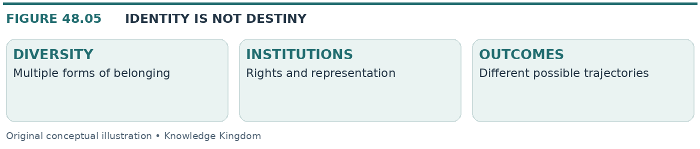

Ethnic identity may include shared language, family traditions, collective memories or a belief in common ancestry. It does not automatically determine political allegiance. A person may simultaneously identify with a religious community, a region, a profession and a nation. Each form of belonging can become more or less politically salient depending on circumstances.

Lars-Erik Cederman, Andreas Wimmer and Brian Min investigated the connection between ethnic politics and conflict, emphasizing the role of access to central state power rather than treating ethnicity as a purely demographic variable. \[<a href="/048-civil-wars-and-fragile-states/sources/#source-13" class="cite">13</a>\]\[<a href="/048-civil-wars-and-fragile-states/sources/#source-14" class="cite">14</a>\] The important distinction is between the existence of different identities and institutions that distribute rights and opportunities unequally along those identities. Ethnic diversity is not itself a moral problem or a sufficient predictor of war.

Consider two hypothetical states with identical population proportions. In one, citizenship, public employment and access to justice are independent of ethnic background. In the other, a dominant party systematically denies a minority political representation. The same diversity statistic masks very different social relationships. Even in the second country, violence is not inevitable: civic organization, political concessions, legal protections and other forms of collective action may lead to peaceful change. What matters is how identities become connected to actual institutions and political choices.

<figure class="figure" id="figure-48-5">

<figcaption>Figure 48.5. Political arrangements matter more than identity categories alone. <a class="figure-anchor" href="#figure-48-5" aria-label="Link to this figure">#</a></figcaption>
</figure>
