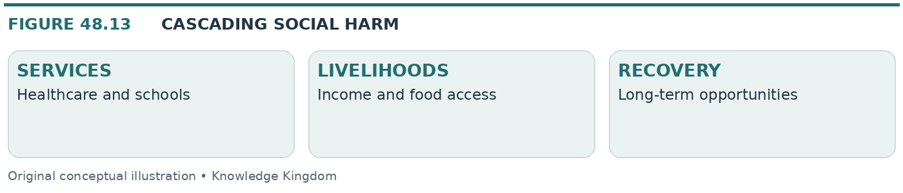

Conflict can undermine a society's ability to sustain life even where individual communities are not experiencing direct fighting. Farmers may lose access to land, supply markets may stop functioning, public health institutions may lack trained staff and schools may close. A breakdown in sanitation may increase the incidence of disease. These consequences are connected: malnutrition makes illness harder to withstand, illness reduces household income, and the loss of income can deepen food insecurity.

The humanitarian consequences of conflict are not confined to combat-related deaths. Indirect harms are difficult to estimate because the relevant comparison is a population's health and living conditions without the conflict. Researchers may examine excess mortality, disease surveillance, nutritional surveys and demographic trends. Each method depends on the quality and coverage of the available data. The absence of a precise estimate should not be mistaken for the absence of harm.

Education creates a particularly long-term challenge. Reopening a school building is only one part of restoring education: children need teachers, accessible transport, records, language support and safety. Students who missed several years may need flexible arrangements rather than being placed in a class solely according to age. A society's recovery also depends on the quality of the education it provides. Teaching collective blame or excluding children because of their family's political identity undermines the civic purpose that education can serve after conflict.

<figure class="figure" id="figure-48-13">

<figcaption>Figure 48.13. The effects of conflict continue beyond direct violence. <a class="figure-anchor" href="#figure-48-13" aria-label="Link to this figure">#</a></figcaption>
</figure>
