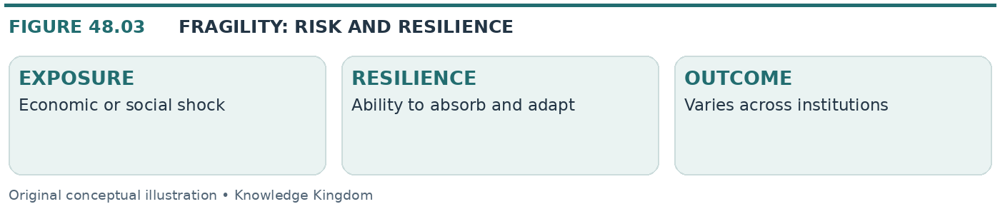

The phrase 'failed state' can suggest an all-or-nothing condition: a country has either succeeded or failed. The concept of fragility is more useful if treated as a spectrum of exposure to danger and the ability to withstand it. The OECD's 2025 framework evaluates risks and resilience across economic, environmental, human, political, security and societal dimensions. It identified 61 contexts with high or extreme fragility under that framework. This is a dated classification, not a timeless verdict on their inhabitants. \[<a href="/048-civil-wars-and-fragile-states/sources/#source-8" class="cite">8</a>\]

A coastal country may be vulnerable to extreme weather while maintaining strong public institutions. A resource-exporting state may have substantial revenue but be vulnerable to a price shock. An apparently prosperous society may lack safeguards against authoritarian abuse. Fragility can appear at the level of a city, institution or community even when national averages look reassuring. It can also change quickly after a political crisis or slowly over generations.

Resilience is the capacity to absorb shocks, adapt and recover. It may come from institutions of government, but also from businesses, families, community associations and local knowledge. During a flood, neighbors who organize temporary shelter may compensate for weak public administration; they cannot necessarily rebuild a national electricity grid. The challenge is to understand where different forms of resilience complement each other and where their limitations become dangerous.

The World Bank's classification for fiscal year 2027 also illustrates why it is important to examine the purpose behind a measurement. It introduced separate public lists for the prevalence of organized political violence and for institutional fragility, rather than combining those concepts in a single list. \[<a href="/048-civil-wars-and-fragile-states/sources/#source-53" class="cite">53</a>\] A country can have serious institutional problems without experiencing a war, and the intensity of violence is not a comprehensive measurement of governance. An agency deciding where to direct development assistance may reasonably use categories different from those used by a researcher studying the origins of civil war.

<figure class="figure" id="figure-48-3">

<figcaption>Figure 48.3. The OECD framework assesses risks across six dimensions \[8\]. <a class="figure-anchor" href="#figure-48-3" aria-label="Link to this figure">#</a></figcaption>
</figure>
