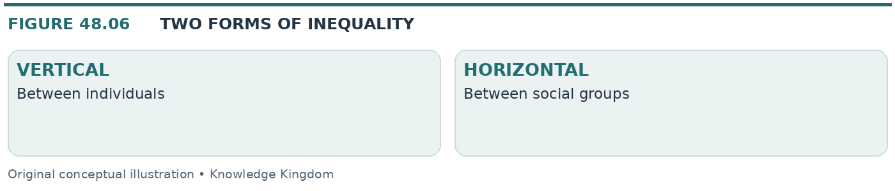

Vertical inequality measures differences among individuals or households. Horizontal inequality refers to differences between socially meaningful groups, such as regions or communities, in access to economic, political or social opportunities. Both can exist in the same country, but a national income distribution does not necessarily reveal the second. \[<a href="/048-civil-wars-and-fragile-states/sources/#source-14" class="cite">14</a>\]

Imagine two countries with the same average household income. In one, wealthy and poor households are distributed across regions. In the other, nearly all public investment goes to one region, while another lacks hospitals and paved roads. The average hides the geography of disadvantage. That does not mean every person from the wealthier region is rich or every person from the poorer region is poor. Group averages must never become assumptions about individuals.

It is important to distinguish inequality from discrimination. A measured gap may reflect different geography, historical investment, unequal policy, demographic conditions or several causes. Evidence of a gap raises questions; evidence of deliberate exclusion requires more investigation. Policy also has multiple dimensions. An infrastructure project may reduce travel costs without addressing unequal political representation. A constitutional reform may recognize equal rights while leaving the underlying service gap untouched. The best analyses ask what actually changed and whether people can obtain remedies when rights are violated.

<figure class="figure" id="figure-48-6">

<figcaption>Figure 48.6. Identical national averages can conceal different group-level distributions. <a class="figure-anchor" href="#figure-48-6" aria-label="Link to this figure">#</a></figcaption>
</figure>
