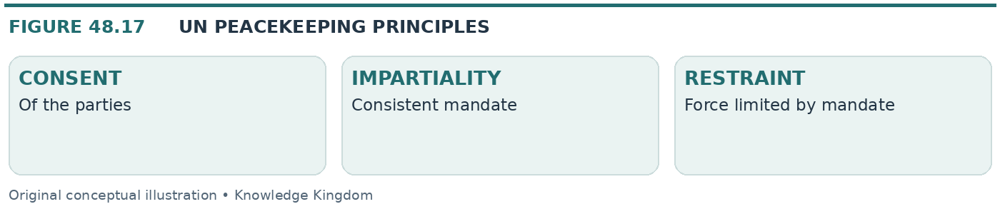

United Nations peacekeeping is guided by three principles: consent of the parties, impartiality and restrictions on the use of force except in self-defence and defence of the mandate. Impartiality does not mean ignoring violations of an agreement or treating evidence of abuses as merely competing opinions. Missions differ in their specific mandates and circumstances. \[<a href="/048-civil-wars-and-fragile-states/sources/#source-44" class="cite">44</a>\]

A peacekeeping operation may assist with civilian protection, monitoring, elections, human rights and other tasks. It is not a world government, and it cannot by itself create a legitimate national political order. A mission's ability to perform its work depends on factors including mandate clarity, resources, access, cooperation and political support. Peacekeeping also requires accountability for the conduct of its own personnel. An institution established to protect civilians undermines its legitimacy when its staff commit abuses or fail to respond appropriately to them.

Studies of peacekeeping attempt to estimate its effects, but missions are not assigned randomly. They are often sent to difficult conflicts where an unassisted peace might be especially fragile. A simple comparison between countries with and without missions may therefore mislead. Researchers such as Virginia Page Fortna have investigated whether peacekeeping contributes to longer-lasting peace while accounting for the characteristics of the conflicts. \[<a href="/048-civil-wars-and-fragile-states/sources/#source-45" class="cite">45</a>\] As in Chapter 6, the selection of cases matters. Even a positive average finding does not guarantee success in every setting or eliminate the need for context-specific evaluation.

The mandate of a particular mission should be read alongside the broader legal and political framework. The United Nations Charter distinguishes peaceful settlement under Chapter VI from measures under Chapter VII, but actual peace operations have evolved in practice and are not reducible to one uniform Charter category. \[<a href="/048-civil-wars-and-fragile-states/sources/#source-61" class="cite">61</a>\] A mission may combine political assistance, monitoring and protection within the mandate given to it. Moreover, a public report that a mission has delivered a specified service does not establish that every community has benefited equally. The standards of conduct applicable to peacekeeping personnel, including the prohibition of sexual exploitation and abuse, must be part of any serious evaluation. \[<a href="/048-civil-wars-and-fragile-states/sources/#source-62" class="cite">62</a>\]

<figure class="figure" id="figure-48-17">

<figcaption>Figure 48.17. Use of force is limited to self-defence and defence of the mandate \[44\]. <a class="figure-anchor" href="#figure-48-17" aria-label="Link to this figure">#</a></figcaption>
</figure>
