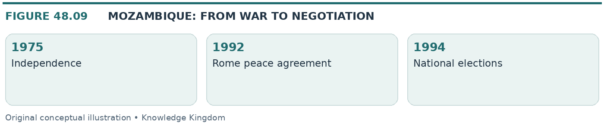

Mozambique became independent from Portugal in 1975. The government led by FRELIMO and the rebel movement RENAMO subsequently fought a prolonged civil war that was closely connected to the regional politics of southern Africa. RENAMO received support from neighboring white-minority regimes, while domestic disputes about political authority and government policies also shaped the conflict. \[<a href="/048-civil-wars-and-fragile-states/sources/#source-22" class="cite">22</a>\]\[<a href="/048-civil-wars-and-fragile-states/sources/#source-23" class="cite">23</a>\] Neither an exclusively Cold War explanation nor a purely domestic account is sufficient.

The peace agreement signed in Rome on 4 October 1992 addressed political competition, guarantees, humanitarian issues and the transition away from armed conflict. The United Nations established ONUMOZ to help oversee implementation. The process included elections and the transformation of former adversaries into participants in a new political framework. Implementation encountered considerable obstacles, and subsequent episodes of violence in Mozambique demonstrate that a successful agreement ending one war does not immunize a country against all later conflict.

The most useful lesson is institutional rather than celebratory. Negotiators did not simply declare that the parties should trust one another. They created provisions that could be monitored and procedures through which contentious questions could be handled. International participation mattered, but the agreement's effectiveness still depended on domestic decisions. A peace process should be understood as the beginning of a difficult relationship between former enemies, rather than a photograph taken at the moment of signature.

<figure class="figure" id="figure-48-9">

<figcaption>Figure 48.9. Selected political milestones \[22\]\[23\]. <a class="figure-anchor" href="#figure-48-9" aria-label="Link to this figure">#</a></figcaption>
</figure>
