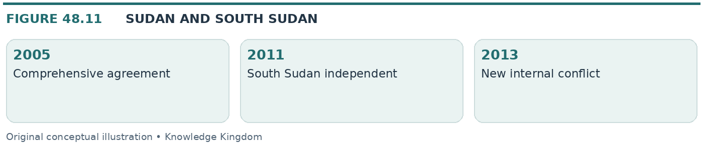

Sudan experienced prolonged internal conflict during the decades surrounding independence and after it. The 2005 Comprehensive Peace Agreement between the Sudanese government and the Sudan People's Liberation Movement created a path toward a referendum on southern independence. South Sudan became an independent state in July 2011. Yet serious conflict erupted within the new country in 2013, and a revitalized peace agreement was signed in 2018. \[<a href="/048-civil-wars-and-fragile-states/sources/#source-33" class="cite">33</a>\]

These events demonstrate that secession may resolve one dispute about the territorial and political relationship between communities while leaving other disputes unresolved. Independence creates a new set of institutions that must manage public revenue, political representation and the distribution of authority. Recognition by other states does not automatically produce effective courts, services or trust among domestic political groups.

A separate conflict began in Sudan in April 2023 between the Sudanese Armed Forces and Rapid Support Forces. Its devastating humanitarian consequences are documented by United Nations agencies, including mass displacement and severe disruption of health and food systems. \[<a href="/048-civil-wars-and-fragile-states/sources/#source-34" class="cite">34</a>\] The conflicts in Sudan and South Sudan should not be conflated simply because the countries share a history. One must distinguish dates, governments, parties and settlements. The example is also a warning against treating state creation as an inherently final solution: the relevant question is whether institutions can handle the next dispute without returning to organized violence.

<figure class="figure" id="figure-48-11">

<figcaption>Figure 48.11. Independence resolved one territorial question, not every political dispute. <a class="figure-anchor" href="#figure-48-11" aria-label="Link to this figure">#</a></figcaption>
</figure>
