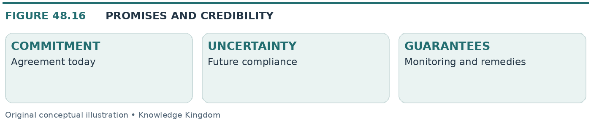

Imagine two fictional political organizations that agree on a new constitutional arrangement. Both publicly promise to respect the results of future elections. Yet each fears that once it has given up its former coercive power, the other may violate the agreement. A promise that is sincere today may be difficult to enforce tomorrow if the political balance changes. The problem concerns the credibility of commitments across time, not simply the personalities of the negotiators.

Barbara Walter's research on civil war settlement emphasizes that former adversaries face distinctive problems in implementing agreements because they must often trust institutions they have previously fought over. Third-party guarantees and enforceable political arrangements may help address these concerns. \[<a href="/048-civil-wars-and-fragile-states/sources/#source-42" class="cite">42</a>\] This insight connects with our discussion of bargaining in Chapter 45: the parties may prefer a peaceful outcome in principle, yet disagree about whether promises will be honored in practice.

Not all guarantees are equally credible. A mediator may lack the authority or resources to ensure compliance; a constitutional provision may lack an independent court; an external actor may change its priorities. The appropriate question is therefore not simply whether a guarantee exists, but who is responsible for it, how compliance is assessed, and what lawful remedies exist if commitments are broken. No guarantee makes future peace certain. The goal is to make peaceful political participation more dependable than the uncertain alternatives.

<figure class="figure" id="figure-48-16">

<figcaption>Figure 48.16. A commitment problem concerns enforcement across time. <a class="figure-anchor" href="#figure-48-16" aria-label="Link to this figure">#</a></figcaption>
</figure>
