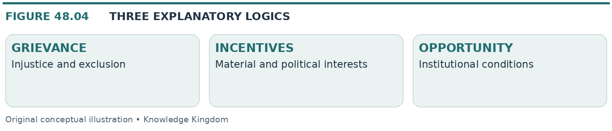

Paul Collier and Anke Hoeffler's influential research tested economic and grievance-related explanations of civil war. Their findings helped shift attention toward the material conditions that make organized rebellion possible, although the interpretation of those findings generated extensive debate. \[<a href="/048-civil-wars-and-fragile-states/sources/#source-10" class="cite">10</a>\]\[<a href="/048-civil-wars-and-fragile-states/sources/#source-11" class="cite">11</a>\] An organization needs resources to sustain itself, and the economic consequences of conflict may create different interests among its leaders, supporters and the wider population.

A war can begin over political exclusion and later become entwined with economic privileges. Conversely, an organization may claim economic grievances even though its leadership pursues political power. Researchers must distinguish public justifications, individual motives and the broader conditions that allow a conflict to persist. The evidence necessary to evaluate each is different. A trade statistic does not establish a leader's personal intention.

The older phrase 'greed versus grievance' is memorable, but it can mislead readers into thinking that only one motive may operate at a time. People can genuinely believe their community has been wronged while a leadership also benefits materially from the conflict. In a separate village, residents might reject both government and rebel authorities while cooperating with whichever institution currently controls basic services. An explanation should allow for these differences rather than treating an entire community as a unified actor.

<figure class="figure" id="figure-48-4">

<figcaption>Figure 48.4. The three approaches need not be mutually exclusive \[10–12\]. <a class="figure-anchor" href="#figure-48-4" aria-label="Link to this figure">#</a></figcaption>
</figure>
