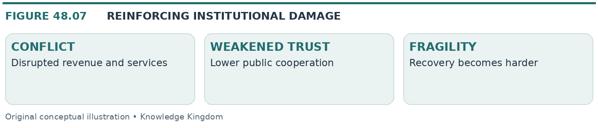

Suppose a public health system loses personnel and tax revenue because of conflict. Families become less able to obtain medical care. Their trust in the institutions responsible for public services may decline, particularly if distribution appears discriminatory. As trust decreases, cooperation with public institutions can become more difficult, which further reduces their effectiveness.

This is a reinforcing feedback loop, but it is not inevitable. A well-supported local clinic, a fair complaint procedure, or an independently monitored public budget may restore confidence in a specific institution even when national politics remain difficult. Recovery often begins unevenly. An improvement in one municipality may not immediately be visible in national statistics, yet it may matter greatly to the people who live there.

The World Development Report 2011 argues that legitimate institutions providing security, justice and economic opportunity are important to breaking cycles of violence. \[<a href="/048-civil-wars-and-fragile-states/sources/#source-7" class="cite">7</a>\] The point is not that a single reform can guarantee peace. Multiple systems depend upon each other: jobs require functioning infrastructure and legal certainty; public institutions require revenue and cooperation; cooperation requires credible and fair treatment. A systems perspective helps explain why short-term emergency assistance and longer-term institutional reform should be assessed together.

These loops also illustrate a problem in evaluating prevention. A successful program may have no dramatic event to display as its achievement. Suppose a district establishes a trusted land-dispute mechanism and no organized violence follows. It is difficult to know whether the program prevented a conflict or whether the district would have remained peaceful anyway. Comparing outcomes with similar districts, examining evidence of grievances resolved, and tracking changes in institutional trust may strengthen the inference. The absence of violence alone cannot prove that a particular preventive intervention worked.

<figure class="figure" id="figure-48-7">

<figcaption>Figure 48.7. A conceptual feedback loop, not an inevitable sequence. <a class="figure-anchor" href="#figure-48-7" aria-label="Link to this figure">#</a></figcaption>
</figure>
