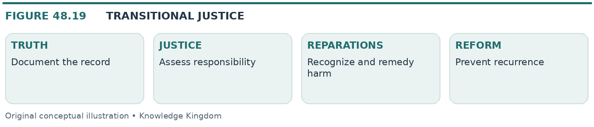

Transitional justice refers to processes through which societies address serious violations of human rights and related legacies during or after political transition. Its mechanisms may include criminal proceedings, truth-seeking, reparations, institutional reform and measures intended to prevent recurrence. \[<a href="/048-civil-wars-and-fragile-states/sources/#source-47" class="cite">47</a>\] These tools have different purposes and evidentiary standards. A truth commission's account is not a criminal conviction; a court judgment concerning one accused person does not establish guilt for every member of that person's community.

The desire for peace can create pressure to avoid politically difficult questions about the past. Yet survivors may reasonably regard a settlement that ignores their experiences as incomplete or unjust. Conversely, prosecutions must respect due process, even when the allegations concern grave crimes. The legitimacy of accountability rests partly on its independence from the politics of collective revenge. International criminal law, discussed in Chapter 46, distinguishes legal categories and individual responsibility precisely because allegations must be assessed against evidence.

Reparations can take material or symbolic forms, depending on applicable law and institutional arrangements. A payment alone cannot erase suffering; an official acknowledgment alone may not meet a survivor's economic needs. Decisions should involve affected people rather than assuming that a government can define the meaning of recovery for them. The ethical objective is not to impose one compulsory national memory. It is to establish a trustworthy record, recognize rights and prevent the denial of dignity that made abuses possible.

<figure class="figure" id="figure-48-19">

<figcaption>Figure 48.19. The mechanisms have distinct purposes and may reinforce each other. <a class="figure-anchor" href="#figure-48-19" aria-label="Link to this figure">#</a></figcaption>
</figure>
