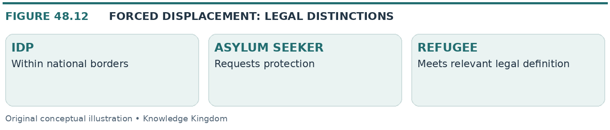

Displacement is not simply movement on a map. A family leaving a home may lose access to employment, education, medical records, property documents and the social relationships on which daily life depends. An elderly person may be separated from a caregiver; a child may spend months without consistent schooling. These disruptions can continue long after direct violence declines.

An internally displaced person (IDP) has been forced to leave home without crossing an internationally recognized state border. A refugee has crossed a border and meets a relevant legal definition; the 1951 Refugee Convention and regional instruments provide important frameworks. An asylum seeker has requested protection and awaits a determination where such a procedure applies. Not every person who crosses a border is legally a refugee, and not every forcibly displaced person crosses one. \[<a href="/048-civil-wars-and-fragile-states/sources/#source-37" class="cite">37</a>\]\[<a href="/048-civil-wars-and-fragile-states/sources/#source-38" class="cite">38</a>\]

UNHCR's November 2026 Mid-Year Trends report estimated that global forced displacement remained between 117 and 119 million at the end of September 2026. This is an estimated stock of people at a given time, not the number newly displaced in that year and not a count exclusively attributable to civil wars. \[<a href="/048-civil-wars-and-fragile-states/sources/#source-39" class="cite">39</a>\] A stock changes through new displacement, return, local integration, deaths and other changes in legal or statistical status. Responsible reporting therefore identifies the date, population definition and uncertainty. More importantly, it recognizes that an aggregate figure cannot describe the circumstances of each person.

Durable solutions for displacement also require careful interpretation. For refugees, possible solutions include voluntary return, local integration or resettlement, each with a legal and institutional dimension. Internally displaced people may return, integrate locally or settle elsewhere within their country. Returning to a particular village is not necessarily a durable solution if a household still lacks safety, documentation or access to essential services because of its displacement. \[<a href="/048-civil-wars-and-fragile-states/sources/#source-58" class="cite">58</a>\] A government that announces a large number of returns therefore has not, by that statistic alone, established that the conditions for sustainable recovery exist. Individual choice and protection must remain central to the assessment.

<figure class="figure" id="figure-48-12">

<figcaption>Figure 48.12. The categories differ; a person’s legal status and circumstances can change. <a class="figure-anchor" href="#figure-48-12" aria-label="Link to this figure">#</a></figcaption>
</figure>
