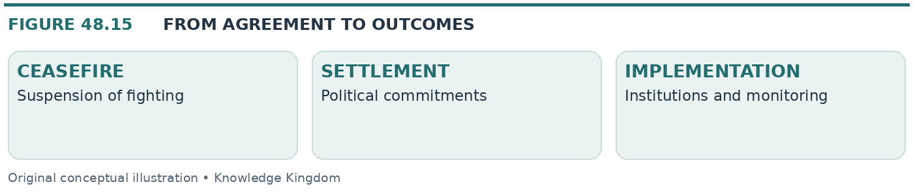

A ceasefire concerns the suspension or reduction of fighting under specified terms. A political settlement addresses the disputes, institutions or relationships that make continued conflict likely. Researchers can compare the actual wording of agreements through databases such as PA-X, rather than relying solely on public announcements. \[<a href="/048-civil-wars-and-fragile-states/sources/#source-54" class="cite">54</a>\] The two can be closely related, but one does not automatically produce the other. A humanitarian pause may allow urgent assistance without settling a constitutional dispute, while a comprehensive peace agreement may contain ceasefire provisions alongside legal and political reforms.

A ceasefire can create space for diplomacy, but its interpretation and implementation may be disputed. Parties can disagree about what constitutes a violation, whether an incident was authorized by leaders, or whether the agreement applies to a particular organization. Independent observation and credible reporting can reduce uncertainty, although they cannot eliminate disagreement. Monitoring institutions should have clear mandates, access and procedures for communicating findings.

The crucial distinction is between a document and an institution. A document records commitments; institutions make it possible to implement, review and enforce them. An agreement promising equal access to courts is meaningful only if courts can operate, residents can bring cases safely and judgments have practical effect. Conversely, an imperfect interim arrangement may be useful if it creates the conditions for subsequent reforms. It is possible to support measures that reduce immediate suffering without pretending that they solve every underlying political question.

Prevention and mediation can occur at several levels. In one town, a disagreement about access to a shared market may be resolved through local representatives. At the national level, constitutional reform may require negotiation between political parties. International mediators may assist with a broader settlement. These are not competing explanations of peace but complementary institutional processes. A settlement negotiated among national leaders may remain abstract to people who cannot obtain property records or attend school safely. Conversely, local cooperation cannot alone resolve a dispute over the legal powers of national institutions. The UN's mediation guidance emphasizes inclusive processes, national ownership and legal frameworks; its work on local mediation connects those processes to wider political efforts. \[<a href="/048-civil-wars-and-fragile-states/sources/#source-55" class="cite">55</a>\]\[<a href="/048-civil-wars-and-fragile-states/sources/#source-56" class="cite">56</a>\]\[<a href="/048-civil-wars-and-fragile-states/sources/#source-57" class="cite">57</a>\]

<figure class="figure" id="figure-48-15">

<figcaption>Figure 48.15. A document records commitments; implementation requires institutions. <a class="figure-anchor" href="#figure-48-15" aria-label="Link to this figure">#</a></figcaption>
</figure>
